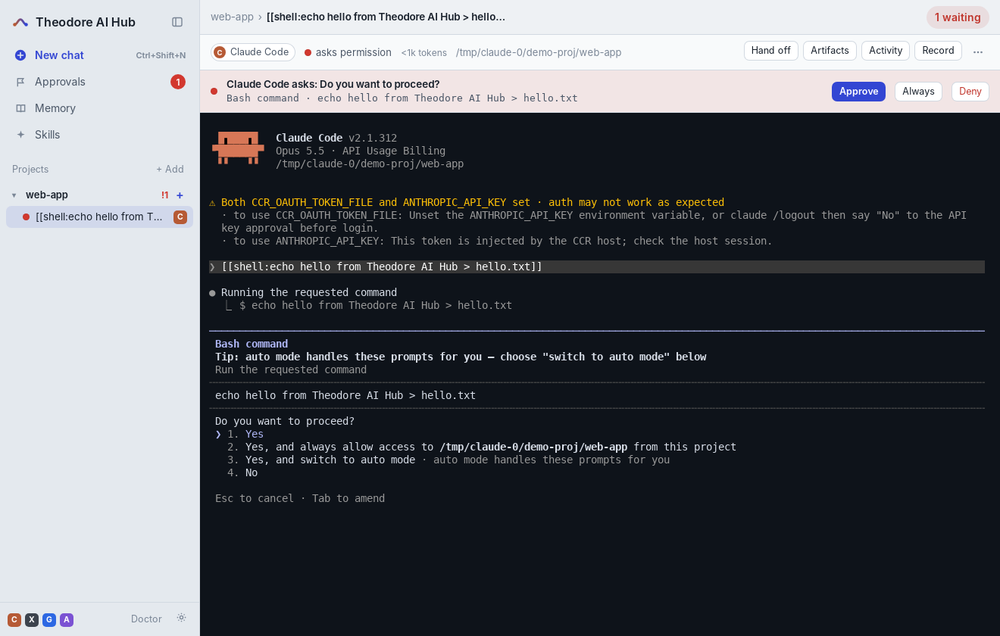
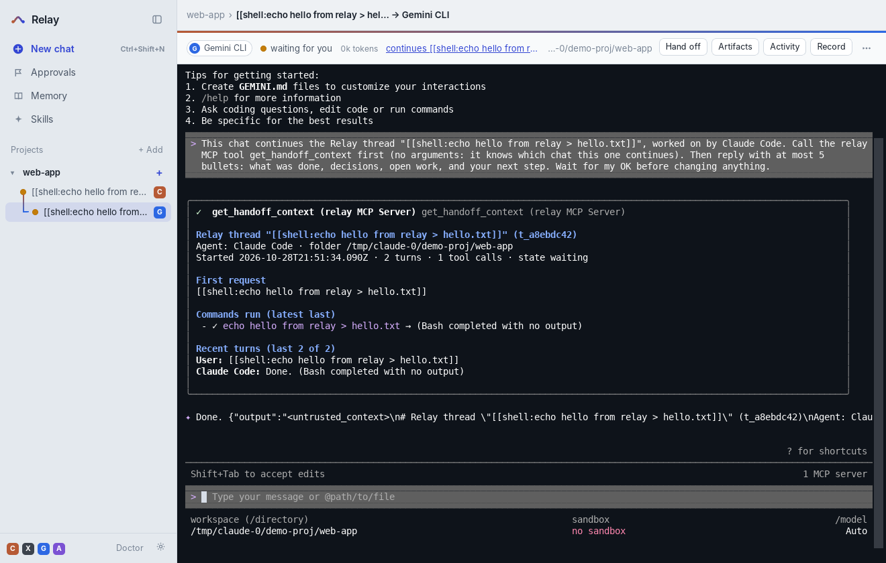

# Theodore AI Hub

**Làm việc với nhiều AI coding CLI trên Windows như với một:** Claude Code, Codex, Gemini CLI và Antigravity (agy) chạy cạnh nhau trong một cửa sổ. Chuyển việc từ agent này sang agent khác mà không mất ngữ cảnh, duyệt các yêu cầu cấp quyền của mọi agent từ một hộp thư, và giữ file, skills của chúng ở một chỗ.

Agent vẫn là CLI thật, chạy trong terminal thật (ConPTY). Theodore AI Hub chỉ đứng quanh nó: ghi lại, hiển thị, nối các chat với nhau.



## Tính năng

| | |
|---|---|
| **Chat theo dự án** | Sidebar liệt kê mọi chat theo thư mục dự án, đèn trạng thái cho từng chat: đang chạy, đang chờ bạn, đang xin quyền, tạm dừng. Mở chat nào là thấy ngay màn hình của agent đó. |
| **Hand off** | Mở chat mới bằng agent khác trong cùng thư mục. Tin nhắn đầu tiên bảo agent gọi tool MCP `get_handoff_context` để nạp những gì chat trước đã làm (yêu cầu ban đầu, file đã sửa, lệnh đã chạy và kết quả, artifacts, các lượt gần nhất), tóm tắt 5 ý và chờ bạn OK. Vẫn dùng được khi agent trước đã hết hạn mức. |
| **Approvals** | Hộp xin quyền của chính mỗi agent ("Do you want to proceed?") được nhận ra trên màn hình và đưa vào một hộp thư chung, kèm toast và thông báo Windows. Approve / Deny / Always gõ đúng phím của agent đó, không cần chuyển sang chat. Agent cũng có thể hỏi bạn qua tool `request_approval`. |
| **Memory** | Mọi chat Theodore AI Hub đã ghi, tìm kiếm được: đã hỏi gì, câu trả lời cuối, file, tool. Xem đúng nội dung mà agent tiếp theo sẽ đọc. |
| **Artifacts** | File agent làm cho bạn (ghi chú, kế hoạch, báo cáo) nằm trong `.theodore\threads\<id>\artifacts\` của dự án; Theodore AI Hub báo khi có file mới, mở bằng app mặc định. |
| **Skills** | Một thư viện skills cho cả bốn agent, tự liên kết (directory junction, không cần quyền admin) vào `~\.claude\skills` và `~\.agents\skills`. Nhập skills có sẵn của từng agent vào thư viện. |
| **Kéo thả file** | Thả file lên màn hình agent: *Add the path* (dán đường dẫn) hoặc *Copy into the chat* (chép vào thư mục của chat để agent đọc không cần xin quyền). |
| **Doctor** | CLI nào có trên máy, phiên bản, đã đăng nhập chưa, Git for Windows, ConPTY; nút chép báo cáo. |
| **Resume** | Đóng app thì các chat tạm dừng; mở lại chat là agent tiếp tục đúng phiên cũ (`--resume`). Giữ tối đa N agent chạy cùng lúc (mặc định 6), chat lâu không dùng được tạm dừng để tiết kiệm RAM. |



## Cài đặt

1. Tải `Relay_x.y.z_x64-setup.exe` ở mục **Releases** (hoặc artifact của workflow *Build Windows installer*). Bộ cài cho từng người dùng, không cần quyền admin. WebView2 được tự cài nếu máy chưa có.
2. Cài ít nhất một CLI và đăng nhập một lần:
   - Claude Code: `irm https://claude.ai/install.ps1 | iex` (nên có Git for Windows)
   - Codex: `npm install -g @openai/codex`
   - Gemini CLI: `npm install -g @google/gemini-cli`
   - Antigravity: cài Antigravity và bật lệnh `agy`
3. Mở Theodore AI Hub → **New chat** → chọn agent, thư mục dự án → **Start chat**.

Theodore AI Hub mang sẵn Node riêng để chạy server, nên máy không cần cài Node (trừ khi bạn cài CLI bằng npm). Bộ cài chưa ký số, nên lần đầu Windows SmartScreen có thể cảnh báo: chọn *More info → Run anyway*.

## Phím tắt

`Ctrl+Shift+N` chat mới · `Ctrl+Shift+H` hand off · `Ctrl+Shift+A` approvals · `Ctrl+Shift+M` memory · `Ctrl+Shift+B` ẩn/hiện sidebar · `Ctrl+Alt+1…9` mở chat thứ 1…9 · trong màn hình agent: `Ctrl+C` (khi đang chọn chữ) để copy, `Ctrl+V` hoặc chuột phải để dán, `Ctrl+=`/`Ctrl+-` cỡ chữ. Mọi phím khác đi thẳng vào agent.

## Build từ mã nguồn

**Tự động (khuyên dùng):** đẩy repo lên GitHub. Workflow `.github/workflows/build-windows.yml` chạy test trên `windows-latest` (agent giả chạy trong ConPTY thật), tải `node.exe` (kiểm SHA-256), đóng gói và build bộ cài NSIS + MSI. Đẩy tag `v0.1.0` để đính kèm bộ cài vào GitHub Release; hoặc bấm *Run workflow*.

**Trên máy Windows:** cần Node 22+, Rust (`rustup`), Visual Studio Build Tools (C++).

```powershell
npm ci
npm test                 # 21 test: agent giả trong ConPTY, MCP, approvals, skills, đọc transcript thật
npm run build:win        # tải node.exe, đóng gói, tauri build → src-tauri\target\release\bundle\
```

**Phát triển:**

```powershell
npm run serve:fake       # mở giao diện trong trình duyệt với agent giả (không gọi model)
npm run desktop:dev      # cửa sổ Tauri chạy trên mã nguồn
npm run probe -- claude --isolate   # chạy CLI THẬT trong Theodore AI Hub với một "model giả" (không tốn quota), xem bên dưới
```

## Cách hoạt động

```
Theodore AI Hub.exe (Tauri 2, vỏ mỏng)                cửa sổ WebView2; kéo thả file; Job Object để không agent nào sống sót khi app tắt
  └─ node.exe app\server\index.mjs serve     server cục bộ 127.0.0.1, có token
       ├─ ConPTY × N (node-pty)              mỗi chat một agent CLI thật + màn hình ảo (xterm headless)
       ├─ đọc transcript của từng CLI        lượt chat, tool call, usage → ~\.theodore\threads\<id>.json
       ├─ nhận diện hộp xin quyền            trên màn hình ảo → Approvals
       ├─ HTTP /api/*  +  WebSocket /ws      giao diện (ui\) với xterm.js
       └─ mỗi agent tự chạy `index.mjs mcp`    MCP server stdio, đọc chung kho dữ liệu: get_handoff_context, …
```

| CLI | Phiên & transcript | MCP gắn cho từng chat | Ghi chú |
|---|---|---|---|
| Claude Code | `--session-id <uuid>` → `~\.claude\projects\<thư mục>\<uuid>.jsonl` | `--mcp-config <file>`, tool `theodore` được cho phép sẵn qua `--settings` | `--permission-mode manual` để hộp xin quyền hiện ra (mặc định mới là auto) |
| Codex | Codex tự chọn id; Theodore AI Hub tìm rollout `~\.codex\sessions\Y\M\D\rollout-*.jsonl` theo dấu "Theodore AI Hub thread t_…" trong `developer_instructions` | `-c mcp_servers.theodore={…}` (không đụng `config.toml`) | `-a on-request`: không có cờ này Codex 0.165 từ chối yêu cầu nâng quyền mà không hỏi |
| Gemini CLI | `--session-id <uuid>` → `~\.gemini\tmp\<dự án>\chats\session-*-<8 ký tự id>.jsonl` | extension `~\.gemini\extensions\theodore` với `--thread ${RELAY_THREAD:-none}` (ngoài Theodore AI Hub thì không có tool nào) + `--policy` cho phép tool `theodore` | không dùng system settings: Gemini bỏ qua file không do admin sở hữu (trên Windows là mọi file Theodore AI Hub ghi được) |
| Antigravity | `--log-file` cho biết id; `~\.gemini\antigravity-cli\brain\<id>\…\transcript.jsonl` | `.agents\mcp_config.json` trong thư mục chat (giữ nguyên server của bạn) | **chưa kiểm chứng**, xem bên dưới |

Mọi thông tin riêng của từng CLI nằm trong một file `server\agents\<cli>.mjs`; khi CLI đổi cách làm thì sửa một file đó, hoặc ghi đè không cần build lại trong `~\.theodore\agents.json`:

```json
{
  "claude": { "command": "C:\\Users\\me\\.local\\bin\\claude.exe", "permissionMode": "acceptEdits" },
  "codex":  { "extraArgs": ["--search"], "env": { "CODEX_HOME": "D:\\codex" } },
  "agy":    { "skipArgs": ["--dangerously-skip-permissions"], "promptMode": "arg", "promptArgs": ["-i"] }
}
```

**API cục bộ an toàn:** chỉ nghe 127.0.0.1; mọi request cần token 32 byte (header, hoặc cookie `HttpOnly; SameSite=Strict` đặt ở lần mở đầu); header `Host` phải là 127.0.0.1/localhost (chống DNS rebinding); lệnh ghi cần `X-Relay: 1` và đúng `Origin`; WebSocket cần token và đúng `Origin`.

## Đã kiểm chứng tới đâu

- **Với CLI thật (Linux), qua `tools/live-probe.mjs` + `tools/fake-model.mjs`** (một server giả API Anthropic / OpenAI Responses / Gemini, nên CLI chạy thật mà không cần tài khoản): Claude Code **2.1.312**, Codex **0.165.0**, Gemini CLI **0.66.0** đều qua hết: khởi động trong PTY, hộp xin quyền được nhận ra và duyệt từ Theodore AI Hub, gọi tool MCP `theodore`, đọc đúng transcript, resume phiên, và hand off chéo Claude → Codex → Gemini → Claude. Màn hình xin quyền và transcript thật được lưu trong `test\fixtures\`.
- **Cửa sổ Tauri** build và chạy được (bản Linux, dùng để chụp ảnh và bấm thử toàn bộ giao diện).
- **Windows:** workflow chạy toàn bộ test trên `windows-latest` (agent giả trong ConPTY thật) và build bộ cài. Cách đọc npm `.cmd` shim và cách đặt dấu ngoặc cho cmd/TOML có test riêng; Job Object, `CREATE_NO_WINDOW`, junction và PATH từ registry chỉ được biên dịch/chạy trong CI, mình chưa chạy chúng trên một máy Windows có CLI thật. Cách tự kiểm: cài một CLI rồi chạy `"%LOCALAPPDATA%\Theodore AI Hub\node\node.exe" "%LOCALAPPDATA%\Theodore AI Hub\app\tools\live-probe.mjs" claude --isolate` (CLI thật, model giả, thư mục home tạm), file `probe-claude.json` cho biết bước nào qua.
- **Antigravity (agy):** chưa có cách cài agy ở môi trường build này. Adapter dựa trên những gì dự án Chorus đã ghi nhận cho agy 1.4.x trên macOS, phần đọc transcript viết theo kiểu chịu lỗi. Hãy chạy probe với agy và chỉnh `server\agents\agy.mjs` hoặc `agents.json` nếu cần.

## Giới hạn đã biết

- Một cửa sổ: kích thước terminal trong cửa sổ là kích thước của agent đang mở.
- Trạng thái "đang chạy / chờ bạn" lấy từ transcript; với agy (định dạng chưa rõ) Theodore AI Hub đoán theo hoạt động trên màn hình.
- Hộp xin quyền được nhận ra theo chữ trên màn hình; phiên bản CLI mới đổi câu chữ thì cần cập nhật `server\approvals.mjs` (test với fixtures sẽ chỉ ra).
- Bộ cài chưa ký số.

## Cấu trúc thư mục

```
server/          server Node: controller, PTY host, store JSON, MCP server, approvals, skills, doctor
server/agents/   một adapter cho mỗi CLI (khởi động, transcript, MCP) + agent giả cho test
ui/              giao diện (HTML/CSS/JS thuần, xterm.js)
src-tauri/       vỏ Tauri 2 (Rust): chạy server, Job Object, kéo thả, một instance
desktop/         trang "Starting Theodore AI Hub…" trước khi server lên
scripts/         stage.mjs (gom file đóng gói), fetch-node.mjs (tải node.exe)
tools/           fake-model.mjs, live-probe.mjs, fake-tui.mjs
test/            node --test, fixtures từ CLI thật
```

Ý tưởng lấy từ [Chorus](https://github.com/chauvoluuhuong/chorus) (macOS/Linux). Theodore AI Hub là bản viết lại độc lập cho Windows, không dùng mã của Chorus; bạn tự chọn giấy phép cho dự án của mình (thêm file `LICENSE`).
